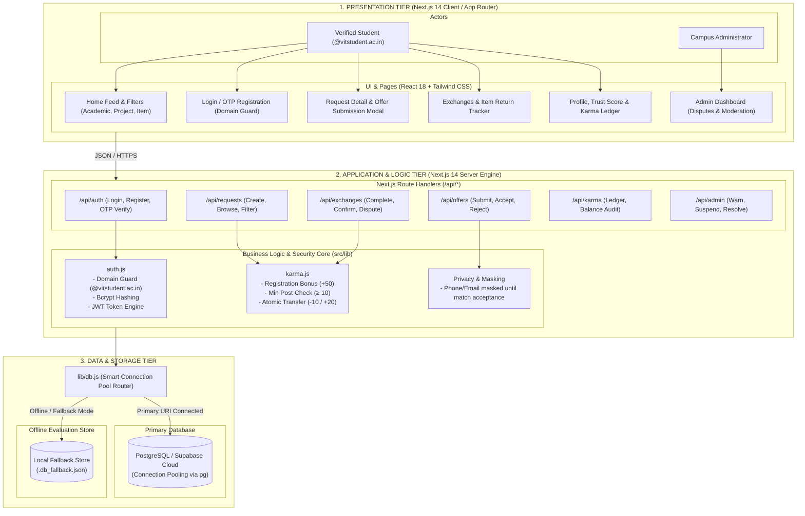
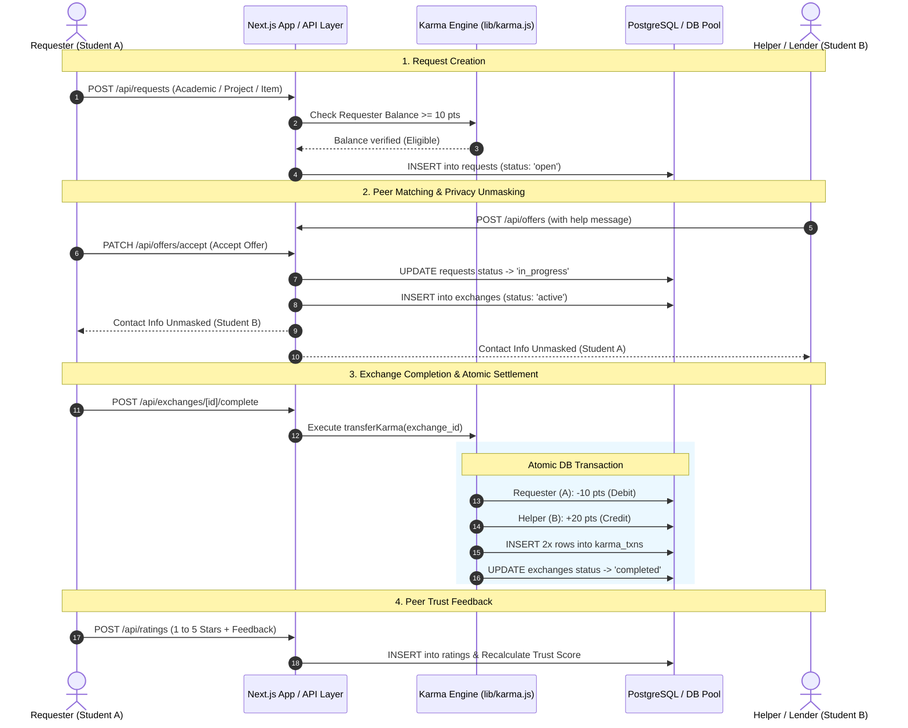
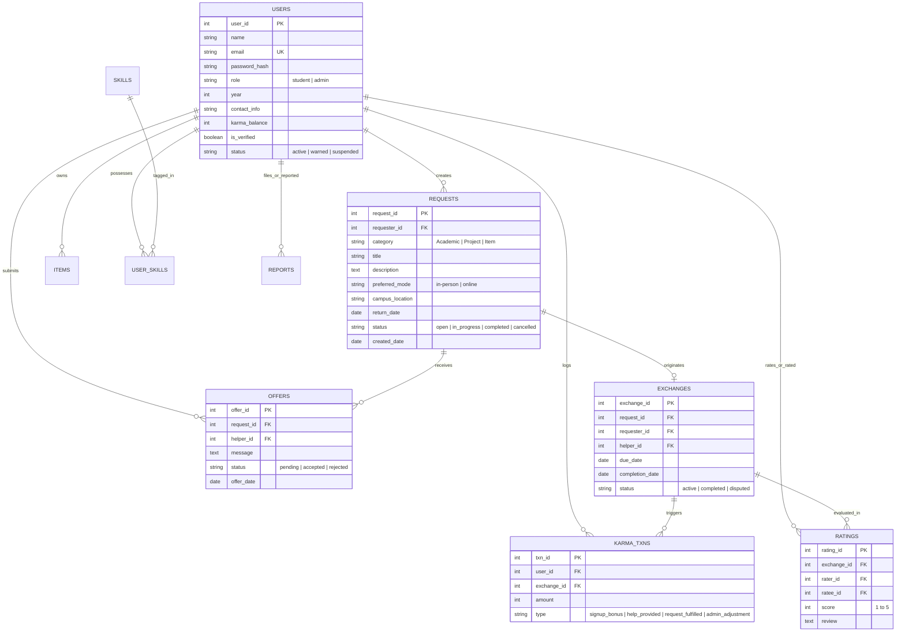

# System Architecture & Technical Design Document

**Project**: P2P Student Micro-Lending Network  
**Course**: Software Engineering Lab (`BCSE301P`)  
**Student**: Abhik Sinha (24BCE1315)  
**Interactive Diagram Exporter**: Open [`architecture_diagrams.html`](./architecture_diagrams.html) in your browser to export any diagram as high-res PNG or SVG.

---

## 1. High-Level 3-Tier System Architecture



---

## 2. Exchange Lifecycle & Karma Settlement Sequence Flow



---

## 3. Database Entity-Relationship (ER) Model



---

## 4. UML Package Diagram

The UML Package Diagram illustrates the high-level structural organization and decomposition of the P2P Student Micro-Lending Network into cohesive subsystems/packages, depicting their namespace boundaries and inter-package dependencies (`<<use>>`, `<<import>>`, `<<access>>`).

```mermaid
flowchart TB
    %% UML Package Diagram for P2P Student Micro-Lending Network

    subgraph PresentationPkg["«package» Presentation Layer (Frontend / Client)"]
        direction TB
        subgraph ViewsPkg["«package» Pages & Views (src/app)"]
            AuthPages["Auth Views<br/>(/login, /register)"]
            FeedPages["Feed & Discovery Views<br/>(/, /requests)"]
            DetailPages["Request Detail & Modal<br/>(/requests/[id])"]
            ExchangePages["Exchange & Tracking Views<br/>(/exchanges)"]
            ProfilePages["Profile & Karma Views<br/>(/profile)"]
            AdminPages["Admin Moderation Views<br/>(/admin)"]
        end

        subgraph ComponentsPkg["«package» UI Components (src/components)"]
            NavComp["Navbar.jsx<br/>(Role & Session State)"]
            CardComp["RequestCard.jsx<br/>(Badge & Action Triggers)"]
            ModalComp["RatingModal.jsx & ReportModal.jsx<br/>(Dialogs & Forms)"]
            BannerComp["DisclaimerBanner.jsx<br/>(Campus Safety & Rules)"]
        end
        ViewsPkg -.->|«import»| ComponentsPkg
    end

    subgraph ControllerPkg["«package» Controller & API Layer (src/app/api)"]
        direction TB
        AuthAPI["«package» auth_api<br/>(/api/auth/*)"]
        RequestsAPI["«package» requests_api<br/>(/api/requests/*)"]
        OffersAPI["«package» offers_api<br/>(/api/offers/*)"]
        ExchangesAPI["«package» exchanges_api<br/>(/api/exchanges/*)"]
        KarmaAPI["«package» karma_api<br/>(/api/karma/*)"]
        RatingsAPI["«package» ratings_api<br/>(/api/ratings/*)"]
        ReportsAPI["«package» reports_api<br/>(/api/reports/*)"]
        AdminAPI["«package» admin_api<br/>(/api/admin/*)"]
    end

    subgraph DomainServicePkg["«package» Domain & Business Services Layer (src/lib)"]
        direction TB
        AuthSvc["«package» Authentication Service (auth.js)<br/>• Domain Guard (@vitstudent.ac.in)<br/>• Bcrypt Password Hashing<br/>• JWT Token Engine & Verify"]
        KarmaSvc["«package» Karma Engine Service (karma.js)<br/>• Registration Bonus (+50)<br/>• Minimum Posting Check (>=10)<br/>• Atomic Balance Transfer (-10 / +20)"]
        PrivacySvc["«package» Privacy & Masking Policy<br/>• PII Redaction (Phone/Email)<br/>• Mutual Match Unmasking"]
    end

    subgraph DataAccessPkg["«package» Data Access & Persistence Layer (src/lib/db.js)"]
        direction TB
        DBPool["«package» Connection Manager<br/>• Pool Lifecycle (pg.Pool)<br/>• Auto Fallback Detector"]
        QueryRouter["«package» Query Abstraction & DAOs<br/>• User DAO<br/>• Request DAO<br/>• Offer & Exchange DAO<br/>• Karma Ledger DAO<br/>• Rating & Report DAO"]
        DBPool --- QueryRouter
    end

    subgraph DataStoragePkg["«package» Data Storage Subsystem"]
        direction LR
        PostgresDB[("«database» Primary Store<br/>PostgreSQL / Supabase Cloud")]
        FallbackDB[("«file» Offline Store<br/>.db_fallback.json")]
    end

    subgraph ConfigPkg["«package» Configuration & Scripts"]
        EnvConfig["«configuration» Environment (.env.local)"]
        DBScripts["«scripts» Schema & Seed (scripts/*.sql)"]
    end

    %% Dependencies between packages
    PresentationPkg -.->|«use» (REST / HTTP JSON)| ControllerPkg
    ControllerPkg -.->|«use»| DomainServicePkg
    ControllerPkg -.->|«use»| DataAccessPkg
    DomainServicePkg -.->|«use»| DataAccessPkg
    DomainServicePkg -.->|«import»| ConfigPkg
    DataAccessPkg -.->|«access»| DataStoragePkg
    DBScripts -.->|«initializes»| DataStoragePkg
```

