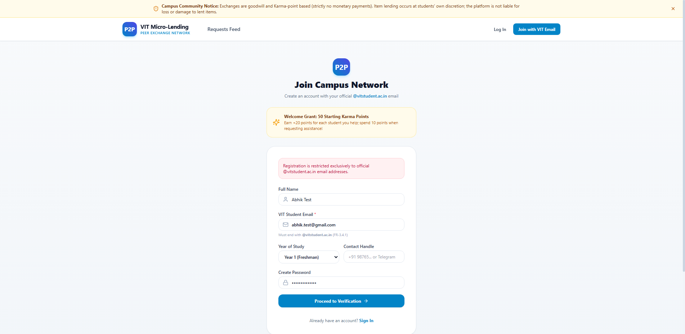
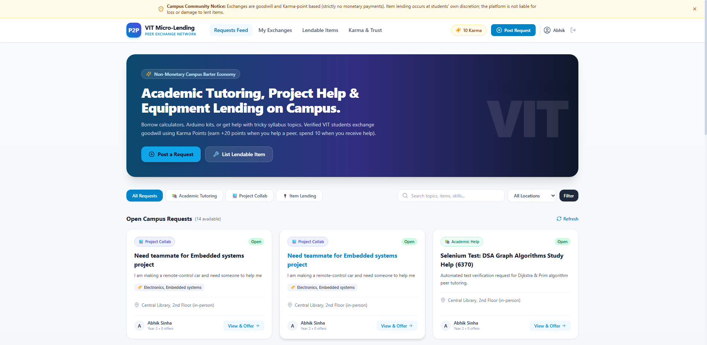
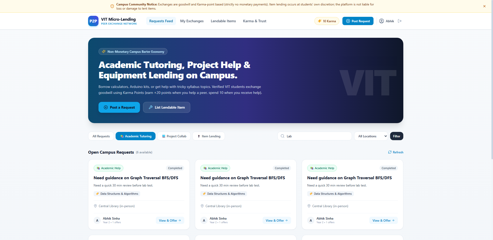
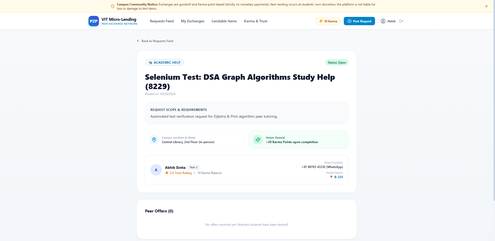
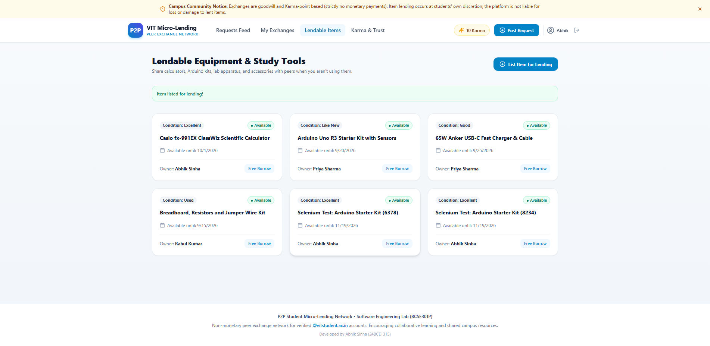
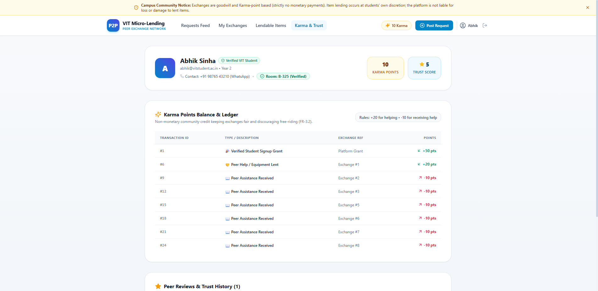

# P2P Student Micro-Lending Network - Selenium Automated Test Execution Report

**Execution Date:** 2026-10-20 23:14:03  
**Target URL:** `http://localhost:3000`  
**Summary:** 6/6 Tests Passed (**100.0%**)

## Test Case Execution Table

| Test ID | Description | Status | Execution Timestamp | Screenshot |
| :--- | :--- | :---: | :---: | :--- |
| `TC-01` | Validate College Email Domain Restriction (@vitstudent.ac.in enforcement) | **PASS** | `2026-10-20 23:13:37` | [`TC01_College_Domain_Validation.png`](./screenshots/TC01_College_Domain_Validation.png) |
| `TC-02` | Student Login & Active Session Verification with Live Karma Balance | **PASS** | `2026-10-20 23:13:42` | [`TC02_Student_Login_Success.png`](./screenshots/TC02_Student_Login_Success.png) |
| `TC-03` | Browse & Filter Peer Requests Feed by Category and Keywords | **PASS** | `2026-10-20 23:13:47` | [`TC03_Feed_Filter_And_Search.png`](./screenshots/TC03_Feed_Filter_And_Search.png) |
| `TC-04` | Create & Publish New Peer Assistance Request (Academic Tutoring) | **PASS** | `2026-10-20 23:13:51` | [`TC04_Request_Creation_Success.png`](./screenshots/TC04_Request_Creation_Success.png) |
| `TC-05` | List Lendable Item in Campus Equipment & Study Tools Inventory | **PASS** | `2026-10-20 23:13:56` | [`TC05_Item_Inventory_Listing.png`](./screenshots/TC05_Item_Inventory_Listing.png) |
| `TC-06` | Student Karma Wallet Ledger, Trust Rating & Hostel Room Verification | **PASS** | `2026-10-20 23:14:01` | [`TC06_Karma_Wallet_Trust_Profile.png`](./screenshots/TC06_Karma_Wallet_Trust_Profile.png) |

## Live Demo Captured Screenshots

### TC-01: Validate College Email Domain Restriction (@vitstudent.ac.in enforcement)

Status: **PASS** | Timestamp: `2026-10-20 23:13:37`

---

### TC-02: Student Login & Active Session Verification with Live Karma Balance

Status: **PASS** | Timestamp: `2026-10-20 23:13:42`

---

### TC-03: Browse & Filter Peer Requests Feed by Category and Keywords

Status: **PASS** | Timestamp: `2026-10-20 23:13:47`

---

### TC-04: Create & Publish New Peer Assistance Request (Academic Tutoring)

Status: **PASS** | Timestamp: `2026-10-20 23:13:51`

---

### TC-05: List Lendable Item in Campus Equipment & Study Tools Inventory

Status: **PASS** | Timestamp: `2026-10-20 23:13:56`

---

### TC-06: Student Karma Wallet Ledger, Trust Rating & Hostel Room Verification

Status: **PASS** | Timestamp: `2026-10-20 23:14:01`

---

